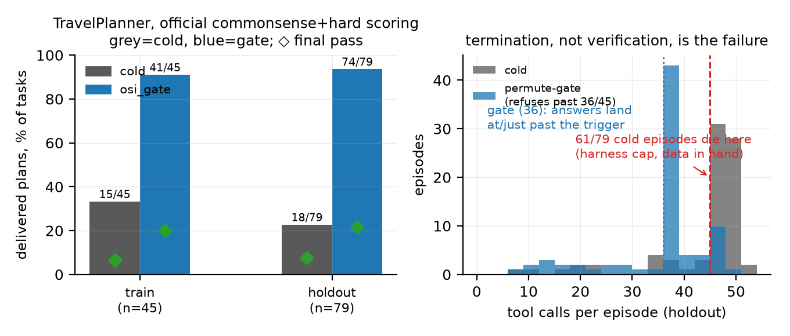

# Open Dream-RSI

[](https://opensource.org/licenses/MIT)
[](https://www.python.org/)
[](https://github.com/patrykorwat/open-dream-rsi/actions/workflows/ci.yml)
[](https://pypi.org/project/open-dream-rsi/)

## What is this?

Every AI agent pays the same tax over and over: it fails a task, works out
what went wrong, and then throws that understanding away when the session
ends. Open Dream-RSI keeps what was learned — **without touching the model**.

The LLM stays **frozen**. What improves is everything *around* it:

- the **exploration policy** (even re-written as Python code by the LLM
  itself, gated by replay before it is trusted),
- a library of **verified solutions** (recipes) reused as warm starts,
- **curated lessons** distilled from failures — every one of them promoted
  only after it *measurably* helps on replay,
- and the **world model** the policy is scored against: a Discovery Tree of
  every attempt, enriched with replay-safe error-class facts by the Sentinel
  engine.

Between runs the system "dreams": it replays thousands of strategies over
the recorded history in-process, at **zero API cost**, and keeps only what
beats the incumbent. An open implementation of *Recursive Self-Improvement
through Evolving Worlds* (Dream-RSI, Zheng et al.,
[arXiv:2609.14858](https://arxiv.org/abs/2609.14858)).

**Zero runtime dependencies** — Python 3.10+ stdlib only, ~11.2k lines of
library code, ~5.4k lines of tests, no build step.

**Not another memory plugin.** Experience-memory systems record what the
agent learned and reuse it as-is. ODR is an *evolving worlds* loop: every
attempt is recorded into a Discovery Tree, and between runs the system
dreams — replaying thousands of strategy variants against that recorded
world. Nothing is promoted on the model's word alone: a candidate policy,
recipe or lesson replaces the incumbent only after surviving counterfactual
replay.

**How it compares** — stored state, how entries earn trust, runtime cost,
against Mem0, Letta, Reflexion-style reflection, DSPy optimizers and skill
libraries: [docs/comparison.md](docs/comparison.md).

> **📄 Preprint:** *Open Dream-RSI: An Open-Source Library for Recursive
> Self-Improvement Around a Frozen LLM, with Replay-Gated Learned Policies and
> a Curated Knowledge Base* — P. Orwat, 2026.
> [**PDF**](paper/main.pdf) · [**LaTeX source**](paper/main.tex)

---

## Quick start

| Agent | Install |
|---|---|
| **Hermes** | `pip install open-dream-rsi` · `hermes plugins install "https://github.com/patrykorwat/open-dream-rsi#odr-trigger"` · `hermes plugins enable odr-trigger` — or in the desktop app: Capabilities → Plugins → **Install from Git** |
| **DeepSeek Harness** | `dsh plugin --profile <name> add dsh-open-dream-rsi` (npm bundle — no pip) |
| **Claude Code** | plugin from this repo: `claude plugin marketplace add patrykorwat/open-dream-rsi` + `claude plugin install open-dream-rsi@open-dream-rsi` (prompts for the task/memory paths; no pip) — or `pip install open-dream-rsi` · `claude mcp add open-dream-rsi -- odr mcp --tasks /ABS/PATH/tasks.json --memory /ABS/PATH/.dream_rsi` |
| **Codex CLI** | `pip install open-dream-rsi` · `codex mcp add open-dream-rsi -- odr mcp --tasks /ABS/PATH/tasks.json --memory /ABS/PATH/.dream_rsi` |
| **OpenCode** | `pip install open-dream-rsi`, then the `mcp` block in [docs/integrations.md#opencode](docs/integrations.md#opencode) |
| **Goose** | `git clone https://github.com/patrykorwat/open-dream-rsi && cd open-dream-rsi && ./scripts/odr_goose_setup.sh` — resolves your provider, starts the proxy, writes the config itself |
| **Claude Cowork / claude.ai** | remote-only: `odr mcp --http --port 8800` behind your tunnel — [docs/integrations.md](docs/integrations.md) |

The `odr` console script ships with the package (0.3.9+); from a bare
checkout use `python3 -m open_dream_rsi` or `pip install -e .`.

Point the dreamer at any OpenAI-compatible endpoint — or nowhere: the model
is auto-detected from `/v1/models`, so a local vLLM/Ollama needs only the
base URL.

```bash
export OPENAI_BASE_URL=http://127.0.0.1:8000/v1   # vLLM / Ollama / any gateway
export OPENAI_API_KEY=***                         # any token for local servers
```

No agent handy? The bare CLI runs the same loop: `odr --memory .dream_rsi
loop --tasks tasks.json --once` (drop `--once` for a daemon). No key?
`python examples/live_loop_demo.py` runs the whole cycle on an in-process
mock server. (`dreamrsi` on PyPI is an unrelated project — this library is
`open-dream-rsi`.) Per-host details, MCP blocks, troubleshooting:
**[docs/integrations.md](docs/integrations.md)**. The key-free walkthrough
and the Docker image: [docs/try-it.md](docs/try-it.md).

---

## How it works

```
                        ┌───────────────┐
                        │  Frozen LLM   │
                        └──────┬────────┘
                               │ proposals
              online loop      ▼      offline dream
        ┌──────────── DiscoveryTree ──────────── ReplaySimulator ──────────┐
        │                     │                          │                 │
        │              node.sentinel              counterfactual          │
        │              (Sentinel facts,           rollout scoring         │
        │               replay-safe)                    │                 │
        │                     │                         ▼                 │
        │                     └────→ Policy improvement ────→ next cycle  │
        │                                                                   │
   SENTINEL MODE (tool-execution layer)                                     │
        │          │             │                                          │
   error-class   nudge       permute-gate ──→ block tool calls             │
   ledger        (once/session)              past 80% of budget ───────────┘
```

1. **Online execution** — the agent attempts each task with the real LLM and
   a sandboxed verifier, appending every attempt to a per-task
   *Discovery Tree* (code, test feedback, score, one-line plan, and — when a
   Sentinel engine is wired — structured error-class facts and an explicit
   termination reason).
2. **Offline dreaming** — instead of paying for real-world rollouts, the
   agent "dreams" over the recorded history: thousands of strategy variants
   are scored in an in-process replay simulator at zero external-call cost.
   The best parameters, programs and recipes are persisted and steer the
   next cycle.

Beyond parameter-level dreaming, the loop closes section 3 of the paper
("dreaming with code"): each cycle the LLM may **rewrite the exploration
policy itself** as a small Python program, `choose_action(frontier, step)`.
Candidates are statically validated (AST gate), executed only in a hardened
subprocess sandbox, and scored by **counterfactual replay rollout** on the
recorded tree. A candidate replaces the incumbent only on evidence — and
the incumbent is re-scored on the *current* tree, not trusted at its stored
score. A crashing or cheating policy can never break the loop: expansion
falls back to the greedy baseline.

---

## Plug in your favourite agent

The loop speaks **MCP** (Model Context Protocol). One config block and your
everyday agent can queue tasks for the dreamer, pull back verified recipes
and consult curated lessons — **zero extra LLM setup**: the dreamer resolves
its own brain (env → local goose config → localhost vLLM), and asks the
endpoint itself which model to use.

| Tool | What it does |
|---|---|
| `odr_status` | what the loop has learned (policies, recipes, events) |
| `odr_recipes` | best **verified** solution for a category — use as warm start |
| `odr_lessons` | curated failure lessons for a category / search query |
| `odr_add_task` | queue a task (prompt + tests, or prompt + criteria) — test-less tasks are completion-judged |
| `odr_run_once` | run one improvement cycle now (bounded API budget) |
| `odr_dream` | the automated cycle: import host session evidence, distill curated lessons, run the promotion gate, publish skills |

Tools are registered prefixed per client (e.g. Hermes
`mcp_open_dream_rsi_odr_run_once`). **No model calls tools on its own
initiative** — trigger them via a recipe's `instructions:`, a hook, or an
explicit ask ("check odr_recipes before you try again"). The `AGENTS.md`
prompting block that makes the loop proactive lives in
[docs/integrations.md](docs/integrations.md).

Per-host setup — OpenCode, Goose (auto-setup script), Hermes (incl. Docker),
Codex CLI, Claude Code, Cowork/claude.ai connectors, DeepSeek Harness — plus
the zero-configuration brain chain and troubleshooting:
**[docs/integrations.md](docs/integrations.md)**.

---

## Providers

| Provider | Preset | Base URL | Key env var |
|---|---|---|---|
| OpenAI | `openai` | `https://api.openai.com/v1` | `OPENAI_API_KEY` |
| Cursor (via local proxy) | `cursor` | `http://127.0.0.1:3000/v1` | `CURSOR_API_KEY` (optional) |
| Cursor Agent CLI (headless, your login) | `cursor-agent` | — (no HTTP) | — |
| Local (vLLM / Ollama / LM Studio) | `local` | `http://127.0.0.1:8000/v1` | `OPENAI_API_KEY` |
| Borrowed from goose config | `goose` | resolved from `~/.config/goose` | — |

Precedence is always: explicit overrides → environment → **endpoint model
discovery** (first id from `GET /v1/models`) → preset defaults; a pinned
model the endpoint no longer serves self-heals by re-discovering once.
Cursor has no public OpenAI-compatible chat endpoint — the `cursor` preset
targets a local proxy over the Cursor login, and since 0.3.0 the default
zero-proxy brain is the `cursor-agent` CLI. Full prose and CLI install:
**[docs/integrations.md](docs/integrations.md)**.

Library-level use (no CLI):

```python
from open_dream_rsi import (DiscoveryTree, DreamEngine, ReplaySimulator,
                            DreamAgent, LLMConfig, OpenAICompatibleClient)

client = OpenAICompatibleClient(LLMConfig.from_preset("local"))
tree = DiscoveryTree()
dreamer = DreamEngine(simulator=ReplaySimulator(tree))
dreamer.run_offline_optimization(iterations=100)
agent = DreamAgent(dreamer=dreamer, client=client)
```

---

## What persists between runs (`--memory` dir)

| Artifact | File | Effect |
|---|---|---|
| Dreamed policy parameters | `policies.json` | next cycle starts from the last one's optimum |
| Promoted policy programs | `policy_codes.json` | LLM-written `choose_action` steers expansion |
| Recipe library | `recipes.json` | verified solutions replayed as warm starts |
| Knowledge base | `lessons.json` | curated, replay-gated lessons (declarative text) |
| Discovery trees | `trees/` | offline dreaming always has history; nodes optionally carry replay-safe Sentinel facts |
| Audit log | `events.jsonl` | append-only record of every decision |
| Holdout reservations | `holdout_reservations.json` | preregistered eval task IDs consumed once (`odr holdout claim/split`) |

Switches worth knowing: `--no-policy-code`, `--no-knowledge`, `--no-thoughts`,
`--no-judge` ablate the four optional machinery layers; `--evolution-stop`
(opt-in) freezes policy regeneration after an anytime-valid betting-martingale
alarm — no promotion evidence left in a category stops the spending, the last
promoted policy stays active; `--budget N` caps API calls per cycle (dreaming
stays free).

---

## Automated dreaming: when does the loop actually run?

The seam is `dream_once()` (CLI `odr dream`, MCP `odr_dream`, or a host
hook). **You do not set a schedule — the module decides the tier per call**,
so firing it after every task is safe and costs nothing extra when there is
nothing new to learn:

| Tier | Triggered when | What runs |
|---|---|---|
| **maintenance** | quiet call (no new evidence, recent last dream) | ingest scan (cheap), ALM stale/supersede/archive/GC, skills republish — **zero LLM** |
| **full** | `min_new_evidence` (default 3) new failure-shaped sessions, OR `max_age_seconds` (default 6 h) since the last full dream | + online attempts, dreaming, paired-replay promotion gate (`budget`, default 100 API calls) |

A busy day dreams a few times, a quiet day once, an idle day never;
concurrent calls collapse on a single-instance lock. **Probes are queued
automatically**: every failure-shaped session appends its *own request* to
`tasks.json` as a `probe:<session>` task (`max_attempts=1`, appended after
manual tasks), so the promotion gate never depends on hand-written task
files — the evidence you already produced is the counterparty.

**An idle fleet is never fully idle (wake self-test).** By default
(`ODR_WAKE=1`, or `--wake`) a FULL dream that finds `tasks.json` empty
seeds one self-test probe — "write `add(a, b)`", verified by tests, one
API call — so the configured endpoint is exercised even with no real
work queued. `odr metrics` then shows live `api_calls` and a solve rate
(category `wake`) instead of a zero-call heartbeat; opt out with
`ODR_WAKE=0` or `--no-wake`.

For a mass install the whole thing is two commands, no host glue:

```bash
pip install open-dream-rsi        # library + CLI + MCP server
hermes plugins install "https://github.com/patrykorwat/open-dream-rsi#odr-trigger"
hermes plugins enable odr-trigger                # restart to load the hook
# optional overrides:
hermes config set plugins.entries.odr-trigger.settings.provider local
hermes config set plugins.entries.odr-trigger.settings.base_url http://.../v1
```

## Fleet deployments: many workspaces, one timer

A timer-based fleet is one runner called by one service. The shipped runner
loops a glob of per-workspace memory dirs and fires one dream cycle per dir:

```bash
scripts/odr_fleet_dream.sh   # env-configured; see the header for ODR_* knobs
```

A systemd oneshot unit + timer (or the per-host service you already run) calls
it; the dream module itself decides maintenance vs full per workspace:

```ini
# /etc/systemd/system/odr-dream.service  (Type=oneshot)
[Service]
Type=oneshot
Environment=ODR_PKG=/opt/odr/share/open-dream-rsi
Environment=ODR_WS_GLOB=/opt/odr/workspaces/*/odr-mem
Environment=ODR_SOURCE=cursor
Environment=ODR_PROVIDER=cursor-agent
ExecStart=/opt/odr/share/open-dream-rsi/scripts/odr_fleet_dream.sh

# odr-dream.timer — fires the unit on your cadence (here: every 2 h)
[Timer]
OnCalendar=*-*-* 0/2:17:00
[Install]
WantedBy=timers.target
```

What separates a *learning* fleet from a heartbeat-only one is carried by the
runner's environment — three ingredients:

| ingredient | switch | without it |
|---|---|---|
| evidence ingest | `ODR_SOURCE=cursor` (or `hermes` + `ODR_SESSIONS_DB`) | sessions are never read; the KB stays empty forever |
| a real dreamer | `ODR_PROVIDER=cursor-agent` (CLI), or `openai`/`local` + `ODR_ENV_FILE` | full dreams attempt nothing; before 0.3.11 this was invisible |
| the workspace glob | `ODR_WS_GLOB` (one memory dir per workspace) | — |

Since 0.3.11 the wake self-test closes the visibility gap: every FULL dream
with an empty queue exercises the configured endpoint once, so a correct
fleet reads `wake: n/n` and ~1 API call per workspace per ~6 h in
`odr metrics`. A fleet stuck at `api_calls: 0` across sweeps is a timer
running bare dream calls — fix the table above, then diagnose one workspace
with `odr --memory <dir> metrics` (the `llm errors` classes name the missing
env). `ODR_INGEST=0` keeps the heartbeat-only behavior explicitly.

---

## Results (evaluation moved to docs/benchmarks.md)

**Evaluation policy:** performance claims live on exactly **one benchmark —
goose × TravelPlanner**, public and scored by the benchmark's *own*
evaluators; the scripted suites (`bench`, `bench-policy`) are deterministic
machinery self-checks and carry no model-quality claim.

On the preregistered eval split (79 tasks, one model): plan delivery
**18/79 (23%) cold → 74/79 (94%) with the call-cutoff gate** (McNemar
56↔0, p=1.4e-17). Every undelivered cold episode died pinned at the call
cap with the data already in hand — the binding failure is *termination*;
the gate arm is fixed choice-removal, no learned content in those episodes.



The learned machinery is validated on the scripted suites; live replay also
showed fresh lessons are hazardous by default (imperative mood, not content:
18/20 → 6/20, declarative restatement back to 18/20) — which is why the KB
is staging-by-default behind a paired-replay gate. Full tables, Wilson
intervals, protocol, self-check contracts and the memory findings:
**[docs/benchmarks.md](docs/benchmarks.md)**.

---

## Learning vs lifecycle vs history

The repository keeps four planes strictly apart:

| Plane | Owner | Question it answers |
|---|---|---|
| **Learning** | Dream-RSI pipeline (dreamer, replay gate, lesson gate) | Does this artifact *deserve* to be active? |
| **Current artifact state** | `ArtifactLifecycleManager` (`lifecycle.py`) | What is true about this artifact *now*? |
| **Transition history** | append-only `artifacts/events.jsonl` | How did it get here? |
| **Immutable evidence** | Discovery Trees + the event logs | Why do these artifacts exist, and what world produced them? |

The ALM manages the four artifact types (`policy_parameters`,
`policy_program`, `recipe`, `lesson`) through an explicit state machine
(`CANDIDATE → VALIDATED → ACTIVE → STALE/SUPERSEDED/QUARANTINED → ARCHIVED`,
terminal `REJECTED`), with hard rules: activation is *only* an explicit
promotion call carrying the evidence; every state change appends exactly
one immutable event **before** exposing the new state; the materialized
view must always equal `rebuild_artifact_state(events)` (a hand-edited view
is rebuilt from the log, never trusted); merges create NEW artifacts with
lineage and never mutate sources; deletion never prunes the event log.
Discovery Trees and audit events are **evidence, not artifacts** — the ALM
refuses to register them. Inspect the store:
`odr artifacts [--type lesson --state ACTIVE --history]`.

---

## Importing real sessions (curator's second door)

The loop distils lessons from its own failures; it can also import the
transcripts you already paid for. **Hermes, Cursor and Claude Code** are
first-class evidence sources, and user corrections are a second evidence
class. Everything imported is untrusted: read-only, secret-redacted, staged
behind the same promotion gate — activation is earned.

| Source | One command |
|---|---|
| Hermes `state.db` | `odr --memory .dream_rsi dream --source hermes --sessions ~/.hermes/state.db` |
| Cursor `state.vscdb` | `odr --memory .dream_rsi dream --source cursor` |
| Claude Code `~/.claude/projects` | `odr --memory .dream_rsi dream --source claude` |

Export-then-distil, corrections classification, backfill of burned sessions,
git-backed lesson stores, holdout hygiene and the full Hermes wiring:
**[docs/sessions.md](docs/sessions.md)**.

---

## Security model

Candidate code — both task solutions and policy programs — runs in a
hardened subprocess (`open_dream_rsi/sandbox.py`): `python -I`, scrubbed
environment (only `PATH` — API keys never cross the wall), a timeout that
kills the **entire process group**, and POSIX address-space / CPU /
thread-count limits. Policy code additionally passes an AST gate *before*
any spawn: required entry point, no imports, no dunder access, no
`__builtins__` reference (name plus constructed-key indexing is itself an
escape route).

**This is defence in depth, not a container.** The subprocess does not
restrict filesystem or network access, and an AST gate cannot be provably
complete against code that is not statically gated. For hostile task
sources set `ODR_SANDBOX_CMD` to a
[bubblewrap](https://github.com/containers/bubblewrap)/nsjail wrapper
(e.g. `bwrap --unshare-all --die-with-parent --ro-bind / /`) or run the
loop inside a container.

On non-POSIX hosts (Windows) the same `python -I` child runs, but there are
no rlimits and the timeout kills only the direct child — treat Windows as
out of scope for hostile task sources. When `ODR_SANDBOX_CMD` is unset,
each fresh process logs a one-time warning naming exactly this gap.

---

## Live dashboard

One command, no dependencies, stdlib http server:

```bash
python -m open_dream_rsi dashboard                   # mock LLM, port 8765
python -m open_dream_rsi dashboard --provider cursor # real model
python -m open_dream_rsi dashboard --host 0.0.0.0    # LAN access
```

Dark single-page UI: KPIs (cycles / solved / API budget / dream iterations),
live event feed, per-task attempt boards with score bars and code diff-downs,
dreamed-policy gauges per category and the learned recipe library.

The dashboard is a plain unauthenticated stdlib HTTP server whose control
routes (`/api/pause`, `/api/reset`) mutate the running loop — keep `--host`
on loopback unless the LAN is trusted.

---

## Positioning

- **The paper this implements:** Dream-RSI
  ([arXiv:2609.14858](https://arxiv.org/abs/2609.14858)); official repo
  [zhengkid/Dream-RSI](https://github.com/zhengkid/Dream-RSI), explainer
  [dream-rsi.com](https://dream-rsi.com/).
- **The broader published line this sits in:** Self-Refine
  ([arXiv:2303.17651](https://arxiv.org/abs/2303.17651)) iterates on outputs
  at test time; Reflexion stores verbal self-feedback across attempts; ExpeL
  ([arXiv:2308.10144](https://arxiv.org/abs/2308.10144)) distils cross-task
  insights and exemplars; Agent Workflow Memory
  ([arXiv:2409.07429](https://arxiv.org/abs/2409.07429)) induces reusable
  workflows; ACE ([arXiv:2510.04618](https://arxiv.org/abs/2510.04618))
  evolves the agent's context as an accumulating playbook — the closest
  published analogue of our recipe store; Early Experience
  ([arXiv:2510.08558](https://arxiv.org/abs/2510.08558)) uses the agent's own
  rollouts as reward-free training signal (a weights-updating neighbour of
  dreaming); the field is mapped by the self-evolving-agents survey
  ([arXiv:2507.21046](https://arxiv.org/abs/2507.21046), TMLR 01/2026). None
  of these promote candidates through counterfactual replay over an evolving
  recorded world — that promotion gate is this library's structural
  difference.
- **Peer implementations** (this repo is an independent open one, not the
  first): [TheAstrayDev/dream-rsi-sdk](https://github.com/TheAstrayDev/dream-rsi-sdk)
  (adapter SDK, strict replay; LLM-written policies on their roadmap),
  [robinber/dream-rsi-spark](https://github.com/robinber/dream-rsi-spark)
  (local Qwen + CUDA kernel exploration), plus skill variants
  ([hermes-dream-rsi](https://github.com/lesterppo/hermes-dream-rsi),
  [dream-rsi-skill](https://github.com/Harkit2004/dream-rsi-skill),
  [Pi-RSI](https://github.com/mailbobg/Pi-RSI)).
  What differentiates this repo: an **always-on autonomous supervisor**
  with budget guards, **LLM-written exploration policies** gated by
  counterfactual replay (section 3 closed), a **public-benchmark
  measurement** (goose × TravelPlanner) rather than self-scored claims, a
  deterministic decoy-trap self-check suite, persistent cross-run memory,
  and a **negative-results section on memory** that the loop itself
  enforces.
- **OpenRSI / Frontis-MA1** ([FrontisAI/OpenRSI](https://github.com/FrontisAI/OpenRSI))
  is a different layer: they post-train *weights*; this library optimises
  the *exploration policy around a frozen model* — no training, no GPU, no
  weight access. Complementary: their trained improver could be the frozen
  LLM behind our client.

---

## Module architecture

| Module | Role |
|---|---|
| `core.tree` | DiscoveryTree — hypotheses, results, actions, thoughts, Sentinel facts, termination reason |
| `core.simulator` | replay simulation without touching the environment |
| `core.dreamer` | offline optimisation over recorded history |
| `core.agent` | LLM agent driven by the rewarded policy |
| `core.policygen` | policy generation, AST gate, rollout scoring, promotion |
| `core.curator` | lesson distillation, headroom verdict, gate verdict |
| `core.judge` | completion judge for test-less (`criteria`) tasks |
| `loop` | `AutoRSIRuntime` — the autonomous supervisor (opt-in `sentinel_engine`) |
| `dream` | `dream_once` — automated cadence seam: evidence ingest, tier decision, gate + ALM, skills publish; lock-guarded |
| `lifecycle` | `ArtifactLifecycleManager` — state machine, event-sourced history, lineage, GC |
| `sessions` | Hermes `state.db` / Cursor `state.vscdb` readers, redaction, lessons→skills bridge |
| `share` | git-backed stores: lessons + worlds + policy programs (checksummed manifest, staging-only import) |
| `memory` | `DreamMemory` — policies, recipes, lessons, trees, events |
| `sandbox` | `run_isolated` — the single untrusted-code execution boundary (+ opt-in content-addressed result cache: `SandboxCache`/`content_key`) |
| `holdout` | single-use eval-task reservations (`claim / release / show / split`) |
| `tools` | `CodeVerifier` — sandboxed verification of candidate solutions |
| `llm` | OpenAI-compatible client (stdlib `urllib` transport; model discovery + 404 self-heal) |
| `cli` | `loop / status / dashboard / bench / bench-policy / gate-replay / mcp / proxy / sentinel / holdout` |
| `mcp`, `mcp_server` | MCP stdio server for loop tools and sentinel checks |
| `proxy` | loopback OpenAI-compatible proxy borrowing goose's upstream |
| `dashboard` | zero-dependency live web UI |
| `gate_replay` | offline validation of the lesson promotion rule |
| `evolution` | anytime-valid stopper for policy evolution (betting martingale over promotion outcomes; freezes regeneration, keeps the last promoted policy) |
| `sentinel` | host-agnostic error-class engine + `SentinelObservation` world contract |
| `utils.goose` | goose config resolver (CLI + desktop dialects, keychain) |
| `plugins/*` | Hermes / Claude Code / goose / DeepSeek Harness / Cursor adapters |
| `benchmarks/travelplanner` | **the benchmark**: sandbox MCP server, episode runner, official-evaluator wrapper, split CSVs, raw published episode records |

## Tests

```bash
python -m unittest discover -s tests      # full suite, ~2 min
python scripts/fast_tests.py              # fast subset (slow bench/sandbox modules excluded), ~15 s
```

Stdlib-only: benchmark
behavioural contracts
(greedy must solve nothing; the gated arm must dominate ε; the rollout must
be prefix-only), sandbox escape regressions, sandbox result-cache identity
contracts, holdout reservation semantics (first-claim-wins, cross-purpose
refusal), gate semantics, MCP protocol,
goose config dialects, sentinel channel semantics (nudge fires once per
budget, merges with recurrence notes, clean calls count toward the budget;
the permute-gate serves until ceil(0.8·budget) then refuses forever, per
session; the 30-day production replay must reproduce its recorded note count
exactly), model discovery and stale-pin self-heal contracts, and the
structured seam (cross-session counts never reach `to_world_dict()`; the
frontier-feature attribution pattern — beats greedy with metadata, ties
without; the vendored Hermes engine pinned byte-for-byte to upstream by
`test_vendored_engine_matches_upstream`).

## License

MIT — see [LICENSE](LICENSE).
